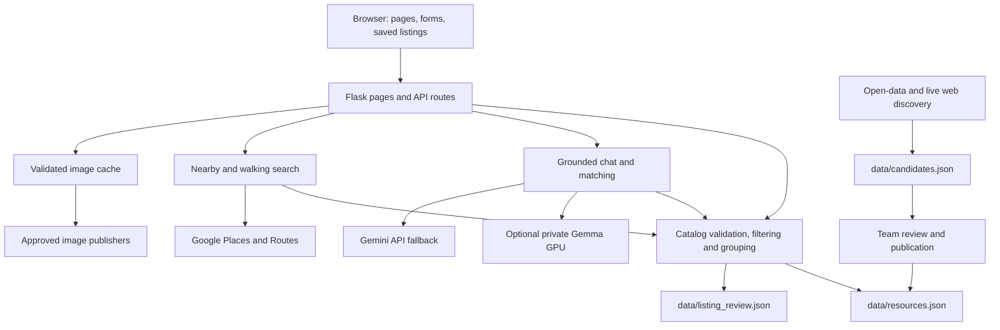

# Architecture and frontend

## System overview

Clear Home is a single Flask application serving plain HTML/CSS/JavaScript and same-origin APIs. There is no frontend build pipeline, SQL database, user account system, or migration framework. The canonical resource database is a versioned JSON file.

The diagram shows responsibility and data flow, not a guarantee that all integrations are configured. Browser Maps JavaScript loads separately using the restricted browser key.

## Backend modules

| File | Responsibility |
|---|---|
| `app.py` | Page/static routes, JSON validation, SSE chat transport, review write restrictions, gzip responses |
| `catalog.py` | Catalog loading, schema checks, hidden-review decisions, deduplication, age/location/rent/freshness filtering, community grouping |
| `advisor.py` | Relevant-record selection, concise prompts, streaming answers, structured cards, keyword shortcuts, estimates and answer caching |
| `matcher.py` | Gemini client/model configuration, optional GPU-first calls, request-to-filter matching |
| `gemma_gpu.py` | Private Ollama-compatible service access, identity authentication, warm-up, cooldown and fallback behavior |
| `nearby.py` | Place/address interpretation, geocoding, nearby rankings, drive/transit/walking queries and labeled estimates |
| `walkable.py` | Dedicated Places/Routes walking search, limits, strict/preferred behavior, route and place-photo helpers |
| `redact.py` | Pattern-based redaction of certain sensitive identifier formats |
| `prompt_tools.py` | Keyword extraction and prompt trimming utilities |
| `sources.py` | Public-source imports into a candidate queue |
| `live_search.py` | Search-grounded, unreviewed discovery results and optional candidate queuing |
| `review.py` | Candidate inspection, approval, and rejection CLI |
| `freshness.py` | Automated provider-page checks that can take listings down, not establish new availability |
| `add_listing.py` | Interactive reviewed-record creation with optional geocoding |
| `geocode.py` | US Census address lookup and catalog geocoding utility |
| `listing_photos.py` | Exact-host HTTPS image fetching, byte validation, bounded downloads and disk caching |
| `photo_audit.py`, `source_audit.py` | Image coverage/dimension checks and source-link auditing |

Use [API reference](API.md) for the HTTP surface. Maintenance scripts may write files; see [maintenance](MAINTENANCE.md) before running them.

## Frontend structure

| File | Role |
|---|---|
| `frontend/about.html` | Landing page, project explanation, Gemma introduction, first-question handoff |
| `frontend/index.html` | Main tools, forms, chat, catalog cards, favorites/share, photo dialog and walking results |
| `frontend/resources.html` | Program explanations, resource lists and follow-up assistant |
| `frontend/google-cloud.html` | Cloud-services explanation |
| `frontend/review.html` | Team review interface |
| `frontend/interface.css` | Shared selection behavior and image attribution/failure styles |
| `frontend/listing-map.js` | Shared map loading and map/listing interactions |
| `frontend/rental-labels.js` | Shared rent, term, and lease-responsibility presentation helpers |
| `frontend/assets/<page>/` | Each page's own styles and scripts, one file per job (see [frontend/assets/README.md](../frontend/assets/README.md)) |
| Logo and favicon assets | Site identity and browser/app icons |

The HTML files hold the markup only. Each page links its own CSS and JavaScript from `frontend/assets/<page>/` in the order they apply, with `?v=<content hash>` so browsers never keep an old copy after a deploy. Serve pages through Flask so `/api/*`, helper scripts, CSS, images and icons resolve correctly; opening an HTML file directly is not equivalent to running the app.

The frontend uses responsive grids, glass-style surfaces, disclosure controls and a native photo dialog. Google Maps is optional, with Leaflet/fallback behavior where implemented. Fonts, Leaflet, maps, and publisher images can need third-party network access. Do not treat cached dependencies or mocked browser responses as a full offline guarantee.

### Editing conventions

Keep accessible names, visible focus indicators, form labels, and readable empty/error states. Keep eligibility caveats, image attribution, and rent basis visible when condensing cards. Render untrusted text as text, not raw HTML. Use shared rental labels instead of presenting every price as whole-apartment monthly rent.

Grouped listing responses contain a base card and floor-plan differences. The current browser restores each plan using `{...row, ...plan}`; consumers must honor explicit null differences. Save/share controls, image enlargement, details disclosures, and map actions must continue to refer to the same record or community after filtering.

`interface.css` limits selection blocking to controls/decorations while preserving useful text. Check specificity against the page stylesheets in `frontend/assets/`. Reduced-motion styles exist, but their presence is not an accessibility certification.

## Catalog lifecycle

1. A team member records evidence or a discovery process writes candidates.
2. Candidate discoveries remain separate from the canonical reviewed catalog until approved.
3. `load_catalog()` excludes unverified, malformed and hidden records, then deduplicates options. Raw review access can request the unfiltered file.
4. `filter_catalog()` applies requested criteria and effective availability rules. A reviewed record may still be unavailable to a particular search because of age, budget, location, accessibility or stale evidence.
5. `group_listings()` builds community cards without reviving excluded floor plans.

Deduplication uses normalized community/option identity, not price alone. A single community can legitimately have several floor plans, subsidy programs or lease arrangements. Raw record count, filtered option count and community count measure different things. Read the schema and review policy in [data/README.md](../data/README.md).

The published catalog is the basis for reviewed recommendations. Live-search source filtering is a discovery aid, not proof of identity, availability, or exhaustive claim-level fact checking. Do not describe discovery as automatic verification.

## AI and fallback flow

Chat selects relevant checked records before creating a grounded prompt. Some place and keyword questions are answered deterministically without AI. When configured, the private GPU is tried before Gemini; GPU startup/error handling lets callers fall back. If AI cannot answer, streaming chat can return checked-resource fallback text and cards. Match and chat endpoints have different error/fallback paths; do not assume every endpoint succeeds without credentials.

The Gemini model name is defined in `matcher.py`. GPU configuration is in `gemma_gpu.py`. Do not put model credentials into HTML. Streaming uses JSON messages within `text/event-stream`, fetched with POST; it is not a WebSocket or a GET-only EventSource interface.

## Storage, caches, and privacy

| Storage | Contents / lifecycle |
|---|---|
| `data/resources.json` | Versioned canonical records; changes require Git publication and deployment |
| `data/candidates.json` | Discovery queue and rejection history |
| `data/listing_review.json` | Versioned local review decisions |
| Photo/source audit JSON files | Dated research and delivery evidence; not live inventory |
| `.cache/listing-photos/` | Ignored, validated downloaded images; may be bundled into deployment |
| Process memory | Catalog, answer, nearby/search and route-related caches; settings vary by module and reset with the process |
| Browser local storage | Saved listings (`clearhome.favorites`) and landing-page GitHub-stat cache |
| Browser session storage | First question passed from the landing introduction to the tools |

Check `frontend/index.html` when changing the favorites storage key. Browser-held favorites can contain old listing snapshots. Chat history is supplied by the client; there is no account-based conversation database. This does **not** mean nothing is retained: answer caches, browser storage, hosting logs and third-party processing have separate lifetimes. Advisor answer caching currently uses a 12-hour in-memory window.

Redaction targets identifier patterns; it does not reliably remove every name, address or sensitive detail. Chat text/profile context may be sent to the configured AI provider. Maps requests and direct publisher image fallback contact third parties. Credentials remain server-side except the intentionally public, restricted Maps browser key.

## Known limitations

- The current pages force a light scheme; automatic device dark mode is inactive.
- Lease uploads/extraction, lease review/signing guidance, e-signatures, applications, accounts and cross-device favorites are absent.
- Catalog sources and review dates are evidence snapshots, not a live vacancy feed or guarantee of safe housing.
- Some records lack images or coordinates; some images are small or cannot be delivered from every network. An image-source match is separate from a native-resolution check.
- Dedicated walking search checks a limited set, not every property. Other chat paths may explicitly estimate time or rent; estimates are not measured routes or provider quotes.
- `/review` uses loopback/read-only checks, not a general authentication system. Proxy/deployment configuration is part of the security boundary.
- The Flask app does not implement comprehensive public API authentication, per-user quotas or a general application rate limiter. Resource caps and caching do not replace those controls.
- Passing local tests does not establish production health, billing configuration, model availability, provider permission, or WCAG conformance.
